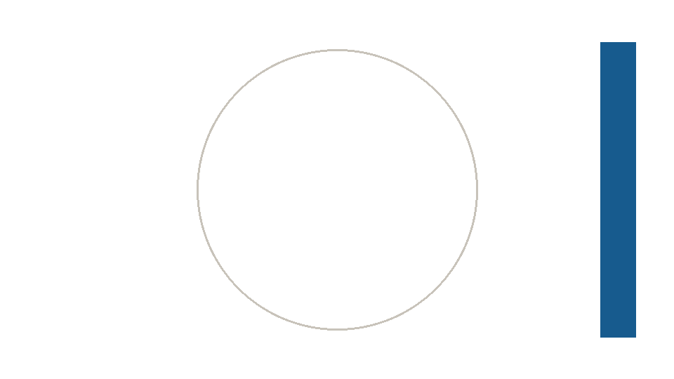

## What this deck is for {role=goals time=1}

- Every construct of the dialect, one per slide, in both outputs.
- A paper slide: [learning goals and takeaways]{.blue} sit on warm paper, with a teal label.
- The plan is printed against the budget after every build.

::: notes
Line: the deck is the engine's test; read it beside the study PDF.
Status: engine release.
:::

## One source, two outputs {role=concept time=2}

```{=latex}
\nmfigureh{4.2cm}{assets/figures/pipeline.tex}
```

- Write one `slides.qmd`; render [a live deck and a study PDF]{.blue}.
- A heading carries a [role]{.blue} and its minutes; the figure is TikZ at display size.

::: notes
Line: the method in one sentence.
Ask: who has kept two versions of the same lecture in sync by hand?
Say: the filter is the only thing that knows about two outputs.
:::

## The budget is checked {role=caveat time=1}

:::: columns
::: {.column width="55%"}
- Every slide heading has `time=`.
- The build prints the plan against the budget.
- Over budget is [a warning, not an error]{.red}.
:::
::: {.column width="45%"}
```{.tikz height=3.6cm label="clock"}
\begin{tikzpicture}
  \draw[nm/hairline] (0,0) circle (1.6cm);
  \foreach \a in {0,30,...,330} \draw[nm/hairline] (\a:1.45cm) -- (\a:1.6cm);
  \draw[nmCaveat, line width=1.6pt] (0,0) -- (60:1.1cm);
  \draw[nmConcept, line width=1.6pt] (0,0) -- (-30:1.4cm);
  \node[nm/muted, below=1.75cm] at (0,0) {15 of 15 minutes};
\end{tikzpicture}
```
:::
::::

::: notes
Line: the clock is the lecturer's, not the slide's.
:::

## A clip, autoplaying {role=example time=1}

:::: {.live-only}
::: {.movie src="assets/clips/bar_bold.mp4" label="A bar sweeps a disc from left to right"}
:::
::::

::: {.study-only}
{height=42mm}

The clip's last frame; the live deck plays the sweep.
:::

::: notes
Say: a click or the space bar pauses the clip, R replays it; the study PDF carries the still.
:::

## A clip through the seam {role=example time=0.5}

::: {.movie clip="bar_bold" height=4cm}
Named in `assets/clips/clips.json`: the live deck gets the video, the study PDF the still, and both the shape.
:::

## A clip on a key press {role=example time=0.5}

- The sweep waits for the presenter's key, then plays from its start.

::: {.fragment}
:::: {.live-only}
::: {.movie src="assets/clips/bar_bold.mp4" label="A bar sweeps a disc from left to right"}
:::
::::
:::

::: {.study-only}
{height=36mm}
:::

::: notes
Say: the fragment wraps the live-only block; frags flags the reverse order.
:::

## A sequence of clips {role=example time=0.5}

:::: {.live-only}
::::: {.r-stack}
::: {.movie src="assets/clips/bar_bold.mp4" label="A bar sweeps a disc from left to right"}
:::
:::: {.fragment}
::: {.movie src="assets/clips/bar_back.mp4" label="The bar sweeps back from right to left"}
:::
::::
:::::
::::

::: {.study-only}
{height=36mm}

The sweep out and, on the next key, the sweep back; one step plays at a time.
:::

::: notes
Say: each key brings the next step; the step it covers stops, and stepping back restarts the earlier one.
:::

## A still from a checkpoint {role=example time=0.5}

::: {.movie clip="bar-bold" still="midway" height=3.5cm}
`still="midway"` names a checkpoint of the clip's entry; the PDF shows the bar halfway.
:::

## A clip from manim8 {role=example time=0.5}

::: {.movie clip="tuning_sweep" height=4cm}
A manim8 project in `clips/`, made by `lk clips`; the PDF shows its last checkpoint.
:::

::: notes
Say: a toy tuning curve; its gain doubles the peak, then its width spreads it.
Status: `lk clips . --only tuning_sweep`, and `--mode dark` for the dark preset.
:::

## A clip in parts {role=example time=1.5}

::: {.movie clip="bar_steps" stops="all"}
`stops="all"` holds the clip at each stop of its entry; the PDF prints the holds.

:::: {.stop ref="left"}
Ask: the bar rests left of centre. Where does it stop next?
::::
:::: {.stop ref="centre"}
Say: each key plays one part; a key pressed during a part plays on to the next stop.
::::
:::: {.stop ref="right"}
Say: Left goes back one hold at once; R replays the part that ends here.
::::
:::: {.stop ref="end"}
Say: an MP4 made elsewhere, brought in by `lk clips adopt` with its stops in seconds.
::::
:::

## A manim8 clip in parts {role=example time=1.5}

::: {.movie clip="tuning_sweep" stops="gain_low gain_high"}
The storyboard marks stops (`stop: true`); the deck chooses which to hold.

:::: {.stop ref="gain_low"}
Ask: the gain doubles next. Where does the peak go, and does the curve widen?
::::
:::: {.stop ref="gain_high"}
Say: the peak doubled in place; next the width grows.
::::
:::

## A kit clip in parts {role=example time=1.5}

::: {.movie clip="gauss-parts" stops="narrowed" start=key}
`checkpoint()` in a kit scene marks the stop; `start=key` waits on frame 0.

:::: {.stop ref="start"}
Ask: the width halves next. What happens to the peak?
::::
:::: {.stop ref="narrowed"}
Say: the peak doubles and the area stays one; next the mean moves.
::::
:::

## Revealed step by step {role=explanation time=1}

::: incremental
- First the question
- Then the data
- Then the model, and where it fails
:::

::: {.study-only}
The study page shows the three points at once; the reveal is a live device.
:::

## A quiz carries its answer {role=question time=1}

Which of the two outputs decides the pixel budget of a slide?

::: {.fragment .live-only}
**The live deck.** 1280 by 720 pixels; the study PDF reflows what the live budget drops.
:::

::: {.study-only}
**Answer.** The live deck. 1280 by 720 pixels; the study PDF reflows what the live budget drops.
:::

## Citations and claims {role=concept time=0.5}

- The model: population receptive fields [@Dumoulin2008].
- The result: joint visual and somatotopic tuning [@Hedger2025].
- Every number on a slide traces to `FACTS.md`; citations are set in italics and, here, small.

## Study-only detail {.study-only role=example time=0}

This slide exists only in the study PDF: a derivation, a table, or a figure
that the live budget drops but the reader wants.

| Construct | Live | Study |
|:--|:--|:--|
| `.live-only` | kept | dropped |
| `.study-only` | dropped | kept |
| `.incremental` | revealed | complete |
| `.movie` | `<video>` | the still |

## Takeaways {role=summary time=0.5}

- One source, [two outputs]{.blue}, one theme file.
- Every rule has a command that checks it.
- The study PDF is the whole argument; the live deck is its spine.

## References {.references .allowframebreaks role=explanation}
